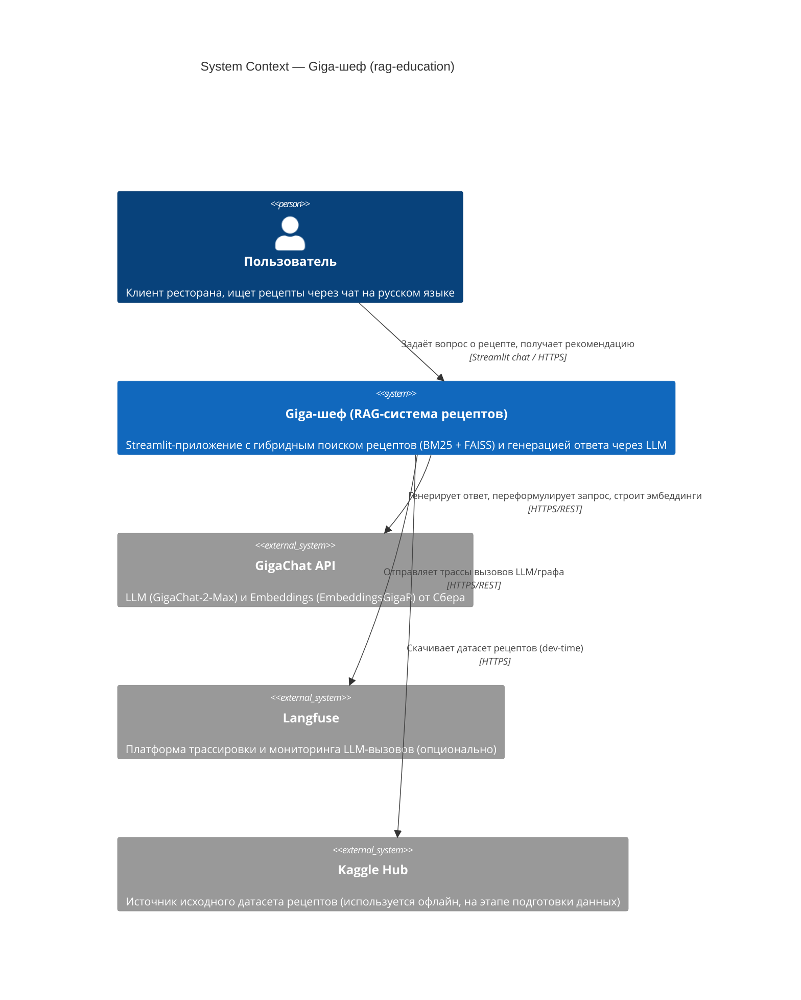
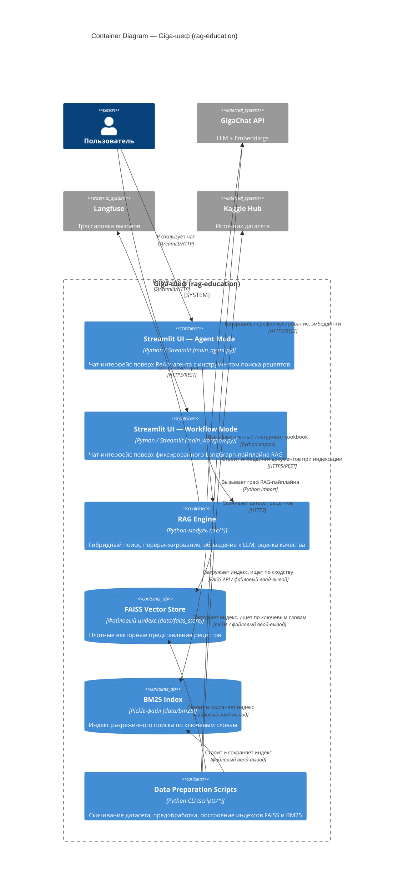
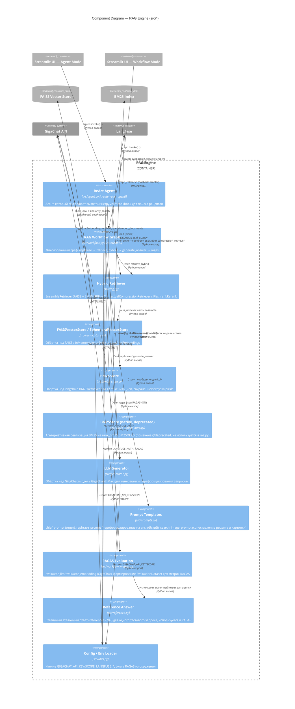

# Архитектура системы «Giga-шеф» (rag-education)

## Обзор

`rag-education` — это RAG-система (Retrieval-Augmented Generation) для рекомендации кулинарных рецептов.
Пользователь общается с системой на русском языке через чат-интерфейс на Streamlit, а система подбирает
подходящие рецепты из локальной базы (датасет рецептов с изображениями блюд) и формирует ответ на естественном
языке с помощью LLM.

Поиск релевантных рецептов реализован как гибридный: разреженный поиск **BM25** (по ключевым словам) и
плотный векторный поиск **FAISS** (по эмбеддингам) объединяются через `EnsembleRetriever` (Reciprocal Rank
Fusion), а затем результат дополнительно переранжируется кросс-энкодером **FlashrankRerank**
(`ms-marco-MultiBERT-L-12`). Для генерации ответов и построения эмбеддингов используется LLM **GigaChat**
(модель `GigaChat-2-Max`) и **GigaChatEmbeddings** (модель `EmbeddingsGigaR`) через библиотеку `langchain_gigachat`.
Оркестрация запросов реализована на **LangGraph** — в проекте присутствуют два альтернативных сценария
запуска: фиксированный граф-пайплайн (`src/workflow.py`) и ReAct-агент с инструментом поиска (`src/agent.py`).
Дополнительно подключены трассировка вызовов через **Langfuse** и офлайн-оценка качества ответов через
**RAGAS**.

Масштаб проекта — учебный/исследовательский прототип (monorepo из одного Python-пакета `src`, без выделенного
backend-сервиса и без базы данных в классическом понимании: индексы поиска хранятся как локальные файлы).

## Технологический стек

| Компонент | Технология | Версия / примечание |
|-----------|-----------|----------------------|
| Язык | Python | 3.11+ (см. README.md) |
| UI | Streamlit | `streamlit` (chat-интерфейс) |
| Оркестрация LLM-сценариев | LangGraph | `langgraph` (StateGraph, `create_react_agent`) |
| LLM-фреймворк | LangChain | `langchain`, `langchain_community` |
| LLM / Embeddings провайдер | GigaChat | `langchain_gigachat` (`GigaChat`, `GigaChatEmbeddings`) |
| Плотный векторный поиск | FAISS | `faiss-cpu` (`IndexFlatIP`) |
| Разреженный поиск | BM25 | `rank_bm25`, `langchain_community.retrievers.BM25Retriever` |
| Токенизация для BM25 | NLTK | `nltk` (корпуса `punkt`, `punkt_tab`, `stopwords`) |
| Переранжирование | Flashrank | `flashrank` (модель `ms-marco-MultiBERT-L-12`) |
| Оценка качества ответов | RAGAS | `ragas` (опционально, флаг `RAGAS` env) |
| Трассировка / observability | Langfuse | `langfuse` (`CallbackHandler`), опционально |
| Источник исходных данных | Kaggle Hub | `kagglehub` (датасет `pes12017000148/food-ingredients-and-recipe-dataset-with-images`) |
| Хранилище векторного индекса | Локальная ФС | `data/faiss_store` (`FAISS.save_local` / `load_local`) |
| Хранилище BM25-индекса | Локальная ФС | `data/bm25/bm25_retriever.pkl` (pickle) |

---

## C1 — System Context

### Описание взаимодействий
- **Пользователь → система**: вводит запрос в чат Streamlit (например, «хочется чего-то острого с чили и свининой»), получает текстовый ответ с рецептом и, при совпадении, изображение блюда.
- **Система → GigaChat API**: используется для (1) переформулирования/перевода запроса на английский (`rephrase_prompt`), (2) генерации финального ответа (`chief_prompt`), (3) построения векторных эмбеддингов документов и запросов, (4) LLM-as-Judge оценки релевантности найденного контекста, (5) в качестве `evaluator_llm` для RAGAS.
- **Система → Langfuse**: если заданы `LANGFUSE_PUBLIC_KEY`/`LANGFUSE_SECRET_KEY`, все вызовы графа/агента дополнительно трассируются через `CallbackHandler`.
- **Система → Kaggle Hub**: используется только на этапе подготовки данных (`scripts/download.py`), не во время работы чата.

---

## C2 — Container Diagram

### Контейнеры

| Контейнер | Технология | Ответственность |
|-----------|-----------|-----------------|
| Streamlit UI — Agent Mode | Python / Streamlit (`main_agent.py`) | Чат-интерфейс поверх ReAct-агента (`src/agent.py`), который сам решает, когда вызывать инструмент поиска `cookbook` |
| Streamlit UI — Workflow Mode | Python / Streamlit (`main_workflow.py`) | Чат-интерфейс поверх фиксированного графа `rephrase → retrieve_hybrid → generate_answer → ragas` (`src/workflow.py`) |
| RAG Engine | Python-модуль (`src/*`) | Общая библиотека: гибридный retriever, обёртка над GigaChat, промпты, конфигурация, метрики RAGAS |
| FAISS Vector Store | Локальный файловый индекс (`data/faiss_store`) | Хранит векторные представления рецептов для плотного поиска |
| BM25 Index | Pickle-файл (`data/bm25/bm25_retriever.pkl`) | Хранит подготовленный `BM25Retriever` для разреженного поиска |
| Data Preparation Scripts | Python CLI (`scripts/download.py`, `preprocess_data.py`, `build_index.py`) | Офлайн-этап: скачивание CSV-датасета рецептов с изображениями, очистка/обогащение метаданных, построение и сохранение индексов FAISS и BM25 |

**Важное замечание об архитектуре**: в проекте нет отдельного backend-сервиса — оба Streamlit-приложения
(`main_agent.py`, `main_workflow.py`) напрямую импортируют модули пакета `src` в своём процессе. Это
модульный монолит, а не микросервисная архитектура. Формальной базы данных (СУБД) в проекте нет — оба индекса
поиска (FAISS, BM25) и исходные данные (`data/raw`) хранятся как файлы на локальной файловой системе.

---

## C3 — Component Diagram (RAG Engine)

### Компоненты

| Компонент | Тип | Ответственность |
|-----------|-----|-----------------|
| ReAct Agent | Python-модуль (`src/agent.py`) | Строит LangGraph ReAct-агента (`create_react_agent`) с инструментом `cookbook`, который сам решает, когда обращаться к retriever'у; содержит системный промпт-инструкцию повара |
| RAG Workflow Graph | Python-модуль (`src/workflow.py`) | Строит фиксированный `StateGraph` с узлами `rephrase`, `retrieve_hybrid` (включая LLM-as-Judge оценку контекста), `generate_answer`, `ragas` |
| Hybrid Retriever | Python-модуль (`src/rag.py`) | Собирает `EnsembleRetriever` (FAISS top-5 + BM25 top-5, веса 0.5/0.5, RRF по ключу `row`) и оборачивает его в `ContextualCompressionRetriever` с `FlashrankRerank` (top-3) |
| FAISSVectorStore / EphemeralVectorStore | Python-модуль (`src/vector_store.py`) | `BaseVectorStore` — общая обвязка над `GigaChatEmbeddings`; `FAISSVectorStore` — персистентный индекс (`IndexFlatIP`, load/save local); `EphemeralVectorStore` — временный `InMemoryVectorStore` |
| BM25Store | Python-модуль (`src/bm25_store.py`) | Обёртка над `langchain_community.retrievers.BM25Retriever` с предобработкой текста через NLTK (`word_tokenize`, стоп-слова), сохранение/загрузка через pickle |
| BM25Store (native, deprecated) | Python-модуль (`src/bm25_native_store.py`) | Более ранняя реализация поверх `rank_bm25.BM25Okapi` напрямую; помечена декоратором `@deprecated`, в текущем pipeline (`src/rag.py`) не используется |
| LLMGenerator | Python-модуль (`src/generator.py`) | Инициализирует и предоставляет модель `GigaChat` (`GigaChat-2-Max`, `temperature=0.3`) для генерации ответов |
| Prompt Templates | Python-модуль (`src/prompts.py`) | Шаблоны промптов: `chief_prompt` (финальный ответ повара), `rephrase_prompt` (выделение кулинарных терминов и перевод на английский), `search_image_prompt` (сопоставление названия рецепта с файлом картинки — используется вручную в `main_workflow.py`, не через LangGraph) |
| RAGAS Evaluation | Python-модуль (`src/workflow_metrics.py`) | Настраивает `evaluator_llm`/`evaluator_embedding` на базе GigaChat и собирает `EvaluationDataset` для метрик RAGAS (`LLMContextRecall`, `Faithfulness`, `ContextPrecision` и др.) |
| Reference Answer | Python-модуль (`src/reference.py`) | Захардкоженный эталонный ответ `reference12709` для одного конкретного тестового вопроса — используется как `reference` в RAGAS-оценке |
| Config / Env Loader | Python-модуль (`src/utils.py`) | Централизованно читает переменные окружения: `GIGACHAT_API_KEY`, `GIGACHAT_API_SCOPE`, `LANGFUSE_PUBLIC_KEY`/`LANGFUSE_SECRET_KEY` (формирует `LANGFUSE_AUTH`), `RAGAS` |

---

## Ключевые потоки данных

### Поток 1: Подготовка данных и построение индексов (офлайн, batch)
1. `scripts/download.py` → Kaggle Hub: скачивает датасет `food-ingredients-and-recipe-dataset-with-images`, перемещает его в `data/raw/pes12017000148`.
2. `scripts/build_index.py` → `CSVLoader`: загружает CSV-файл с рецептами (`Food Ingredients and Recipe Dataset with Image Name Mapping.csv`) как набор `Document`.
3. `scripts/build_index.py` → `scripts/preprocess_data.py`: вызывает `extract_meta_and_propagate` (извлекает `title`, `image`, `ingredients` из текста в метаданные и `doc.id`), `cleanup`, отфильтровывает документы длиннее `SZ_LIMIT=6000` символов.
4. `scripts/build_index.py` → `FAISSVectorStore`: строит векторный индекс через `GigaChatEmbeddings`, сохраняет в `data/faiss_store`.
5. `scripts/build_index.py` → `BM25Store`: строит BM25-индекс (NLTK-токенизация), сохраняет в `data/bm25/bm25_retriever.pkl`.

### Поток 2: Диалог пользователя — режим Workflow (`main_workflow.py`)
1. Пользователь вводит вопрос в Streamlit chat (например, «Порекомендуй рецепт настойки на водке и ягод»).
2. Узел `rephrase` (`src/workflow.py`) → GigaChat: переформулирует и переводит запрос на английский по `rephrase_prompt`.
3. Узел `retrieve_hybrid` → `Hybrid Retriever` (`src/rag.py`): выполняет параллельный поиск FAISS + BM25, объединяет через `EnsembleRetriever` (RRF), переранжирует через `FlashrankRerank`; дополнительно каждый найденный документ оценивается вызовом GigaChat как LLM-as-Judge (оценка 0–1 полезности контекста).
4. Узел `generate_answer` → GigaChat: формирует финальный ответ по `chief_prompt` с учётом найденного контекста.
5. Узел `ragas` (если `RAGAS=ON`) → RAGAS/`workflow_metrics.py`: прогоняет метрики качества (`LLMContextRecall`, `Faithfulness`, `ContextPrecision`, `AnswerRelevancy` и др.) на сформированном датасете из одного примера.
6. Streamlit UI сопоставляет номер рецепта (`row`) из ответа с полученными документами (`retrieved`) и, при совпадении, отображает изображение блюда из `data/raw/pes12017000148/Food Images/Food Images/`.
7. Ответ и (опционально) вызовы графа отправляются в Langfuse через `graph_callbacks`, если заданы ключи.

### Поток 3: Диалог пользователя — режим Agent (`main_agent.py`)
1. Пользователь вводит вопрос в Streamlit chat.
2. `ReAct Agent` (`src/agent.py`) получает сообщение и самостоятельно решает, вызывать ли инструмент `cookbook`.
3. Инструмент `cookbook` → `Hybrid Retriever` (`src/rag.py`, тот же `compression_retriever`, что и в Workflow-режиме): выполняет гибридный поиск и переранжирование, возвращает агенту текстовое содержимое найденных рецептов.
4. Агент (модель GigaChat) формирует финальный ответ на русском языке в формате markdown, указывая номер строки (`row`) и оригинальное английское название рецепта.
5. Streamlit UI отображает ответ пользователю (без сопоставления с изображением — в отличие от Workflow-режима).

---

## Известные ограничения и технический долг

- **Несоответствие импорта и файловой структуры**: `main_workflow.py` импортирует `graph` и `graph_callbacks` из `src.rag_pipeline`, однако файла `src/rag_pipeline.py` в проекте нет — соответствующий функционал фактически находится в `src/workflow.py`. При текущем состоянии кода `main_workflow.py` не запустится без переименования модуля или добавления файла `src/rag_pipeline.py`.
- **Дублирование реализации BM25**: в проекте присутствуют две реализации BM25-хранилища — актуальная `src/bm25_store.py` (используется в `src/rag.py`) и устаревшая `src/bm25_native_store.py`, помеченная `@deprecated`, но не удалённая из кодовой базы.
- **Нет формальной базы данных**: оба поисковых индекса (FAISS, BM25) хранятся как файлы на локальной ФС без версионирования, репликации или контроля доступа; `config/config.yaml`, упомянутый в структуре проекта, присутствует, но пуст (0 байт) — конфигурация фактически ведётся через переменные окружения (`src/utils.py`) и константы прямо в коде (`src/rag.py`, `src/workflow.py`).
- **Секреты в примере окружения**: `.env-example` содержит поля для `GIGACHAT_API_KEY`, `LANGFUSE_PUBLIC_KEY`, `LANGFUSE_SECRET_KEY` — реальные значения должны передаваться через `.env` (в `.gitignore`), не через код.
- **Жёстко заданный эталонный ответ**: `src/reference.py` содержит единственный статический `reference12709`, используемый для RAGAS-оценки независимо от заданного пользователем вопроса — это корректно работает только для одного demo-сценария (настройки/рецепт с ребрышками), а не как универсальный эталон.
- **Дублирование логики извлечения метаданных**: функция `extract_field` продублирована в `scripts/preprocess_data.py` и `src/bm25_native_store.py` (Unknown / TBD, требуется ли единая реализация — не установлено из кода).
- **Прямые вызовы `agent.invoke(...)` / `graph.invoke(...)` на верхнем уровне модулей** (`src/agent.py:52-61`, `src/workflow.py:121-127`) — выполняются при обычном импорте модуля (в том числе при импорте из Streamlit UI), что приводит к обращению к GigaChat API и побочным print-выводам уже на этапе загрузки приложения, а не только по действию пользователя.
- **`search_image_prompt`** (`src/prompts.py`) описан, но не подключён ни к `src/agent.py`, ни к `src/workflow.py` — сопоставление рецепта с изображением в `main_workflow.py` реализовано отдельной эвристикой на регулярных выражениях (поиск номера `row` в тексте ответа), а не через LLM-промпт.
- **Тесты**: каталог `tests/`, упомянутый в `structure.txt` (README-описание структуры проекта), в текущей файловой структуре репозитория отсутствует.
